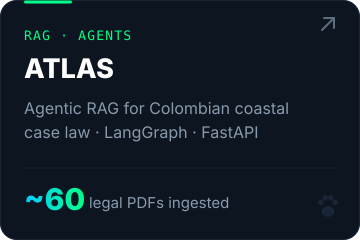
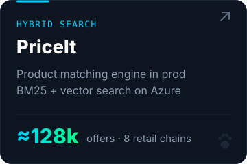
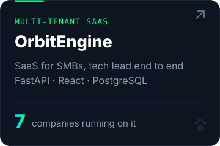

  
  
  
  

AI Engineer (B.Eng. in Computer Science and AI, Cum Laude 2026). I build RAG systems and LangGraph agents that reach production, backed by Python/FastAPI on Azure.

ES · Ingeniero en IA que construye sistemas inteligentes que llegan a producción.

<h3></h3>

- **Project Engineer @ InConcert** · 3 projects led end to end on an omnichannel contact center platform
- **Backend Developer @ Indetech Consulting** · product matching for [PriceIt](https://priceit.com.co/), ≈128k offers across 8 retail chains

<h3></h3>

  
  
  

Also: [NeuroChallenge](https://neuro-challenge.online/) (cognitive training platform) · [Gizmo Dev Studio](https://play.google.com/store/apps/developer?id=Gizmo+Dev+Studio&hl=es_CO) (my mobile studio, Flutter)

<h3></h3>

  

RAG · LangGraph · MCP · hybrid search (BM25 + vector) · embeddings · ChromaDB · Ollama

<h3></h3>

Cum Laude · Honors Program ×3 · Speaker at Data Fest 2026 (ATLAS) · AWS Cloud Club Core Team

Certifications

 

- [Claude Code in Action](https://verify.skilljar.com/c/uektezzg6do2) · Anthropic · 2026
- Machine Learning and Deep Learning (4 courses) · DataCamp · 2025 - 2026
- Database Design and Programming with SQL · Oracle Academy · 2024

 

